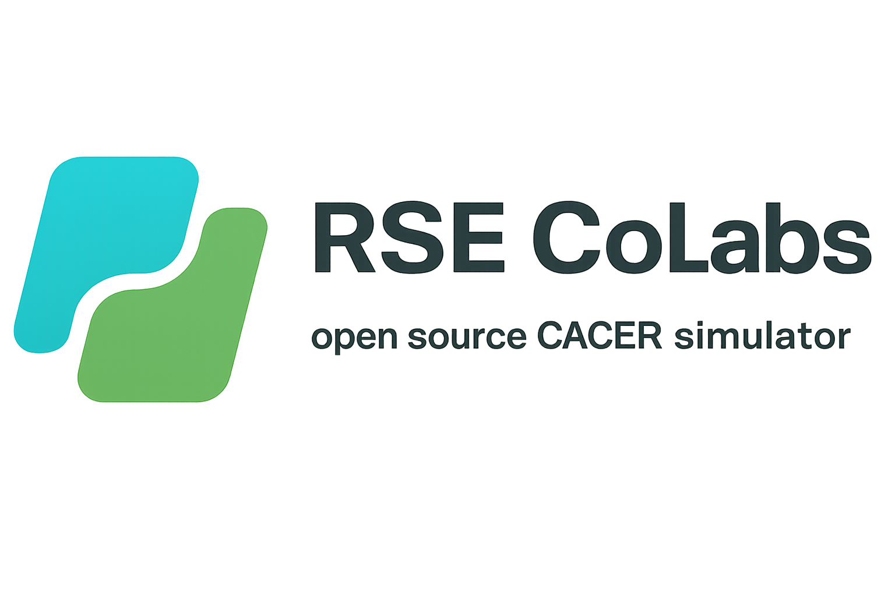
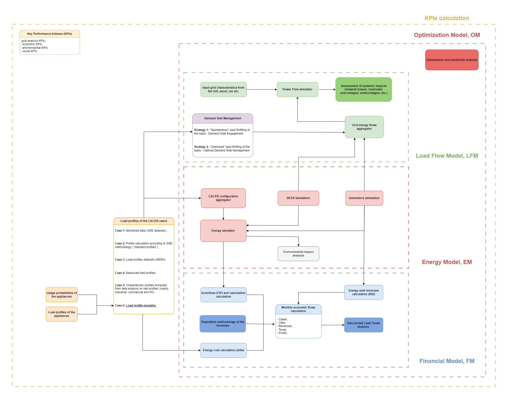

<div style="display: flex; align-items: center; justify-content: space-between; width: 100%;">
  
  
</div>

---

# CACER Simulator

This repository contains a simulation framework for assessing the **energy**, **economic**, and **financial** performance of renewable energy sharing configurations, with a focus on CACER configurations such as Renewable Energy Communities, collective self-consumption groups, and groups of remote self-consumers.

The simulator combines energy-flow modelling, user and plant registries, tariff and market inputs, incentive assumptions, and financial analysis. A typical workflow starts from static inputs grouped by domain under `input_data/`, computes production and consumption profiles, evaluates shared energy and grid exchanges, optionally applies storage logic, estimates bills and revenues, and finally produces economic and financial indicators.

The full simulation is exposed through `source/pipeline/CACER_simulator.py`,
which is the only full-simulation entry point. It runs the domain pipelines in
order, writes isolated outputs under `output_data/RunN/`, and records completion
or failure in `run_summary.json`. The repository also includes a MkDocs
documentation site under `documentation/`.

> **Architecture migration:** the new `source/` package provides collision-safe
> run directories, pipeline interfaces, and typed result contracts. The main
> orchestrator executes configuration, load, energy, grid, finance, and
> reporting in order. Domain results pass in memory, while each pipeline writes
> only to its own folder below the current `output_data/RunN/` directory.
>
> The shared structures in `source/data_structures/` include value-only
> building, heat-pump, PV, battery, user, plant, and simulation configuration
> objects. `config_pipeline.py` constructs their registries from inputs under
> `input_data/config/`; these constructors do not read files or global state.

## What the simulator evaluates

- **Energy performance**: photovoltaic production, user demand, self-consumption, shared energy, self-sufficiency, grid import and export.
- **Economic benefits**: electricity bill savings, revenues from exported energy, CACER incentives and valorizations.
- **Financial indicators**: cash-flow analysis, Payback Period, Net Present Value (NPV), Internal Rate of Return (IRR), and stakeholder-level project views.
- **Configuration behaviour**: user, plant, configuration, stakeholder, CACER, and overall project perspectives.

## Flow chart CACER simulator

<div style="text-align: center;">
  
</div>

For detailed module documentation, see the pages in `documentation/docs/`, especially:

- `documentation/docs/tutorials/pv_simulator.md`
- `documentation/docs/tutorials/load_emulator_v1.md`
- `documentation/docs/modules/bess_simulator.md`
- `documentation/docs/modules/financial_model.md`

---

# Prerequisites

You'll need:

- **CPython 3.14.7**, the accepted migration and baseline runtime.
- The exact dependencies pinned in `requirements.txt`.
- Microsoft Excel when executing the remaining finance operations that use
  `xlwings`.

---

# Installation

Clone the repository by downloading the folder or using Git:

```bash
git clone https://github.com/RSE-CoLabs/CACER_Simulator.git
```

## Create and validate the virtual environment

From the repository root, run:

```powershell
py -3.14 setup_venv.py
```

The script creates `.venv`, installs `requirements.txt`, verifies that the
interpreter belongs to that environment, checks every pinned package version,
and runs `pip check`. It exits with a nonzero status if validation fails.

To validate an existing environment without installing packages:

```powershell
py -3.14 setup_venv.py --validate-only
```

Custom locations are supported through `--venv` and `--requirements`.

## Run the simulator

Execute the only full-simulation entry point:

```powershell
.\.venv\Scripts\python.exe -m source.pipeline.CACER_simulator
```

With no additional options, this runs the repository's native default
scenario:

- load emulator v1;
- simulated PV;
- heat pumps disabled;
- battery dispatch enabled;
- native grid creation with load flow disabled;
- native finance execution;
- native generation of the complete accepted reporting set.

The command requires only the versioned inputs under `input_data`; it does not
use frozen baseline artifacts or injected stage callbacks.

Each invocation creates a collision-safe `output_data/RunN` directory with
domain subfolders and `run_summary.json`. A stage failure preserves the run
directory and records the failed stage and exception. The summary records both
the selected scenario modes and the effective modes reported by each stage.

Programmatic callers can construct validated high-level options:

```python
from source.data_structures import SimulationOptions
from source.pipeline import run_simulation

options = SimulationOptions.from_modes(
    load_mode="emulator_v1",
    hp_mode="disabled",
    pv_mode="simulated",
    battery_enabled=True,
    grid_enabled=False,
    finance_enabled=False,
    reporting_enabled=False,
)
results = run_simulation(options=options, random_seed=42)
```

The example above deliberately disables grid, finance, and reporting to show a
partial programmatic run; `SimulationOptions()` itself selects the complete
native default scenario described above.

The energy pipeline supports native `non_optimized` and `optimized` heat-pump
modes, an explicit external HVAC profile, or a disabled mode. Native modes
receive weather, coordinates, building archetypes, schedules, PV production,
and solver settings through `HVACOptions`; HVAC calculation modules do not read
configuration or intermediate result files. The default building archetypes
preserve the accepted frozen baseline, and callers can override them explicitly
through `energy.settings["hp_options"]`.

The complete native energy path combines simulated or external PV, native or
external HVAC, optional active battery dispatch, per-user and aggregate energy
flows, shared energy, incentives, and valorizzazione. Calculations exchange
in-memory values; `energy_pipeline.py` is the only energy output owner and saves
run-local tables, including HVAC profiles, under `output_data/RunN/energy`.
Location keys remain explicit: the frozen PV input uses `Milan`, while the HVAC
weather boundary uses `Milano`.

The six active frozen-baseline building definitions remain directly under
`input_data/energy/buildings`. The broader legacy archetype catalog and its
supporting reference material are preserved under
`input_data/energy/buildings/archetypes`; calculations only load an archetype
when it is selected explicitly.

## Native parity matrix

Run the complete native parity gate with:

```powershell
.\.venv\Scripts\python.exe tools\run_final_parity.py
```

The gate executes all eight combinations of load emulator v1/v2, optimized/
non-optimized heat pumps, and enabled/disabled battery dispatch. Every
scenario also runs simulated PV, grid load flow, finance, and reporting in
native execute mode. Frozen fixtures are opened only after execution as
comparison oracles; they are never supplied to a downstream stage.

The example grid workbook models 59 PODs while the main configuration contains
two representative user profiles. The parity scenarios therefore declare an
explicit type mapping that assigns the consumer and prosumer profiles to the
corresponding POD types. Grid violations are recorded and checked against the
persisted analysis rather than hidden or replaced by frozen load-flow results.

Each run writes `scenario_parity_report.json`. The final run also writes
`final_parity_report.json`; success requires the exact status
`"parity_passed"`.

---

# Repository Structure

- `input_data/config/`: configuration inputs and cross-cutting reporting presentation inputs.
- `input_data/load/`: load-emulator, DSM, ARERA, and external profile inputs.
- `input_data/energy/`: building, heat-pump, weather, and external energy inputs.
- `input_data/finance/`: market, RID, PUN/PZO, fee, and financial-model inputs.
- `input_data/grid/`: static network definitions.
- `output_data/RunN/`: isolated outputs for each new pipeline run.
- `source/`: domain-oriented pipelines and typed in-memory result contracts.
- `setup_venv.py`: root environment creation, installation, and validation entry point.
- `input_data/config/config.yml`: the only main simulation configuration.
- `requirements.txt`: exact dependency versions validated by `setup_venv.py`.

---

# Citations

## Pvlib citation

This project makes use of the [pvlib](https://github.com/pvlib/pvlib-python) library, which is licensed under the BSD 3-Clause License.

Copyright (c) 2013-2024, pvlib developers.

Redistribution and use in source and binary forms, with or without modification, are permitted provided that the following conditions are met:

1. Redistributions of source code must retain the above copyright notice, this list of conditions and the following disclaimer.
2. Redistributions in binary form must reproduce the above copyright notice, this list of conditions and the following disclaimer in the documentation and/or other materials provided with the distribution.
3. Neither the name of the pvlib organization nor the names of its contributors may be used to endorse or promote products derived from this software without specific prior written permission.

## Numpy Financial citation

This project uses [NumPy Financial](https://github.com/numpy/numpy-financial), which is licensed under the BSD 3-Clause License.

Copyright (c) NumPy Developers.

Redistribution and use in source and binary forms, with or without modification, are permitted provided that the following conditions are met:

1. Redistributions of source code must retain the above copyright notice, this list of conditions and the following disclaimer.
2. Redistributions in binary form must reproduce the above copyright notice, this list of conditions and the following disclaimer in the documentation and/or other materials provided with the distribution.
3. Neither the name of the NumPy organization nor the names of its contributors may be used to endorse or promote products derived from this software without specific prior written permission.

## Icons Attribution

Some icons used in this project are designed by Flaticon and are licensed under the Flaticon Basic License.
